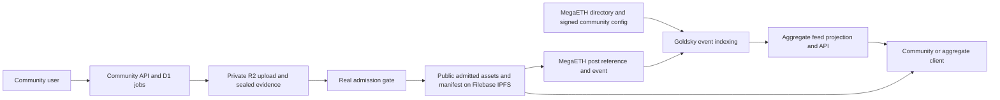

# Decentralized contract boundaries

Contract boundaries and local directory/post implementation, 2026-11-04.
The workspace_owner requested explicit contracts and confirmed human Dance
review. The directory and shared post index now implement the reviewed V1 ABIs
with local authorization, revision and event tests. See the
[implementation profile](community-implementation.md) for constructor inputs,
URI checks and remaining acceptance. No deployment or real first song is claimed. The existing
[setup plan](../decentralized-setup.md) and [operator protocol](../operator-protocol.md)
retain their admission, creator activation and registration gates.

## Inventory and authority

| Area                       | Authority and responsibility                                                                                               | Inspected state / next boundary                                                                                                                                                                             |
| -------------------------- | -------------------------------------------------------------------------------------------------------------------------- | ----------------------------------------------------------------------------------------------------------------------------------------------------------------------------------------------------------- |
| SLD naming                 | TLD owner delegates through HNS; registry admin controls sale policy; SLD holder or record manager controls app records.   | `pirate-registry` implements SLDRegistry and RegistryFactory. Testnet rehearsal exists. Factory provenance does not prove TLD ownership.                                                                    |
| Community directory        | Registry admin self-registers; community controls config/publisher. Pirate verifies namespaces and selects listings.       | [Directory authorization](community-directory.md) implemented locally; real namespace and account acceptance remain.                                                                                        |
| Rules and roles            | Community controls admission policy; LearningRecords owns public qualification-policy activation and grader authorization. | No separate governance contract required for first song. Future delegated roles belong to community authority, not Pirate's listing administrator.                                                          |
| Song and video publication | Community publisher submits admitted, immutable content references under a scoped author ID and pays gas.                  | [Post index](community-posts.md) implemented locally; video admission still needs its own policy. No media in contract storage.                                                                             |
| Comments                   | Community-local author and content policy.                                                                                 | On-chain representation remains open. No comment ABI or automatic public pinning is introduced.                                                                                                             |
| Operator work payments     | Community purchase authority buys bounded operator work.                                                                   | OperatorPayments and per-line accounting live on the active segment-payments branch; not reimplemented here.                                                                                                |
| Study, Karaoke and Dance   | Typed assessment records; distinct graders, including human owner review for Dance.                                        | [LearningRecords draft](learning-records.md) and [assessment adapters](assessments-rewards.md); wallet identity and Dance review-day credit are proposed defaults; no grade-contract implementation exists. |
| Daily qualification        | Sponsor-approved verifier evaluates frozen task policy, deduplicates entries and commits a drawing root.                   | Karaoke policy already specifies periods, thresholds and retry deduplication. Multi-task acceptance and assessor authorization need an extension.                                                           |
| Reward pots and bridge     | Separate funding, custody, purchase, bridge reconciliation and claim accounting.                                           | Existing RewardPool is a local single-sponsor/single-drawing experiment. Cross-chain/shared-pot replacement is not implemented or ratified by this slice.                                                   |

The directory stores the canonical community-approved config pointer and hash,
not editable copies of every rule. A later community governance contract may
become its controller; it would authorize updates through the same interface.
There must remain one current config revision, not competing policy pointers
owned by Pirate and the community. Delisting changes discovery only.
Controller-authorized publisher revocations in that manifest govern feed
quarantine after compromise; rotation alone does not repair forged revisions.
Every config body must be pinned, retrieved and verified before its transaction.
An EOA controller can complete the testnet first-song milestone, with a tracked
handoff and verified recovery required before mainnet or real-user onboarding.
[Safe](governance-accounts.md) is a candidate alongside MOSS; account acceptance
remains separate from code verification. These rules add no on-chain recovery
override or automatic history migration.

The proposed [namespace verifier authority](namespace-verifier-authority.md)
separates a rotatable automated service key from its recoverable governance Safe.
Only typed verification to one directory is delegated. The proposed
[listing authority](community-listing-authority.md) gives its governance Safe
normal listing control and a separate emergency key only delisting power.
Both contracts are specified but unimplemented prerequisites before directory
deployment; they do not change the current directory/post ABIs. Maximum evidence
age is a security ceiling per attestation, not a bound on an active attacker
who keeps renewing false evidence.

## Content and read path

The registration adapter has separate activation and confirmed-receipt states;
it is omitted from this storage diagram for readability, not removed as a
first-release dependency. Song bytes are stored in the media layer; DATA is
the external asset-registration boundary. Neither a CID nor a MegaETH post
receipt establishes IP registration. See [media publication](media-publication.md).

[Goldsky indexing](feed-indexing.md) can build per-community and aggregate feeds
from the events. A subgraph is already an available option, not dependent on a
future chain launch. Indexing cannot supply missing bodies, authorize authors,
prove HNS control, grade a performance or enforce eligibility for Pirate funds.

## Order of implementation

Directory authorization and post publication now have local implementations and
tests. Next connect the creator flow, upload/seal/admission jobs, real providers, DATA testnet
registration and feed reads. The separately admitted wizard v1 starts on
ordinary HTTPS; HNS is an optional follow-up for that slice and Spaces is
post-MVP. An EOA operator can bootstrap the directory without waiting for a
MOSS first transaction. These are integration paths, not acceptance already run.

The first-song testnet milestone uses a genuine unverified test registry and
ordinary HTTPS, with real admission, registration, interrupted resume and a
song that plays after reload. HNS verification gates Pirate discovery; verified
discovery and app.tld browser acceptance remain separate follow-ups under the
setup plan. EOA control does not downgrade a successful test run to a rehearsal,
but its receipt must show incomplete recovery. Admission means real
pre-publication evidence and the publication gate, not a new moderator dashboard.

HTTPS-only communities stay unlisted in V1 until the matching HNS binding is
verified. Their own feeds and direct post pages still work independently of
Pirate discovery. HTTPS-domain verification is not being added as a shortcut;
if HTTPS-only discovery becomes required, revise that ABI before deployment.

Then implement LearningRecords with actual graders, learner consent, an accepted
public-identity policy and the agreed shared learning clock. Its manifest
coverage, payment-status mapping and categorical/non-line adapters need
implementation design before an ABI is fixed. Human Dance review alone grants
no Pirate-funded reward authority. Later roles remain community-controlled.

Finally define and implement multi-task qualification, the adopted funding/pot
model, Base custody if approved, and a measured bridge route with recovery.
Comments, Base custody, Dance eligibility for Pirate-funded drawings and
decentralized adoption of the centralized shared-pot/open-funding direction
remain explicit decisions. Wallet-linked grades and Dance credit on the first
on-chain review day are the recommended simple defaults in draft 3, not items
settled by the earlier three-part approval. Neither recommendation authorizes
public record emission. These later choices do not block writing or implementing the directory and post contracts.

## Source baseline

This slice starts from operators guidance `3d44fd8`, with the restored protocol.
It also inspected payment source `0dec600`, registry source `296c97d`, static
client `388018f` and creator design `9c7899b`. These are separate lanes and
maturity levels. The branch now integrates guidance through `ba36312`, preserving
published branch history. LearningRecords draft 3 is copied byte-for-byte from
the revised staging source at this handback,
with a [source digest](learning-records-source.json) and predecessor provenance.
It corrects the identity approval claim and local song key, and proposes an
explicit Dance review clock. The earlier task approved three clarifications;
it is not broad approval of every draft field. The latest correction also
separates Dance address/service enforcement and publication delays. Payment
specification `412c098` is included as an exact documentation copy: it defines
unattempted and performanceEndedAt, with the latter setting Karaoke's learning
day. Its runtime is published separately in [PR 14](https://github.com/pirate-social-club/pirate-operators/pull/14)
at that same commit, not included in this branch. Protocol section
12.1 records the reiterated Very-only joining direction; membership, sponsorship
and claim scopes remain separate. A branch SHA is not evidence that GitHub
reviewed or tested it.

New ABI source is under `contracts/interfaces/community/`; the
[source index](../../contracts/README.md) records existing ownership. Existing
`packages/protocol/` is retained. No active payment or frontend file moves,
new provider account, deployment or funded operation belong to this slice.
