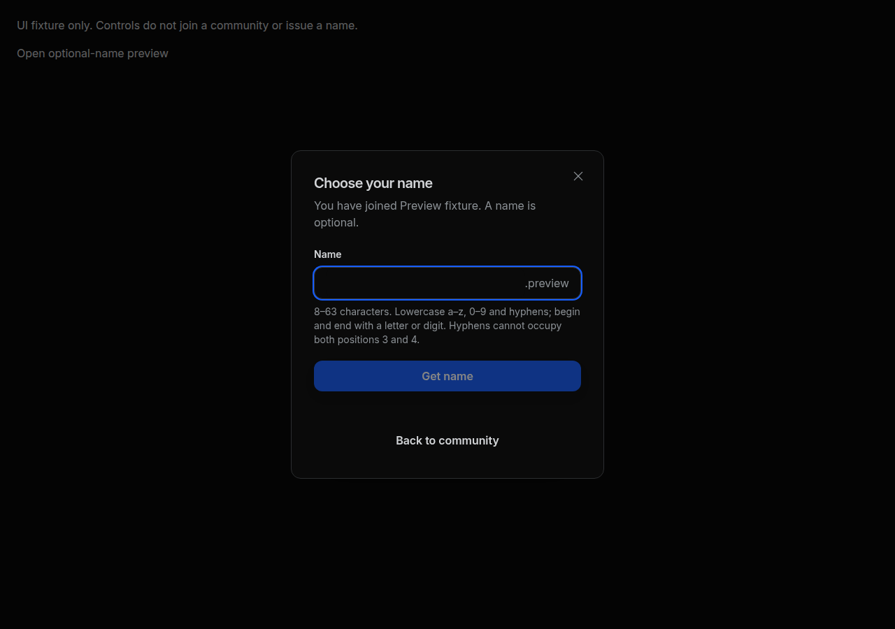
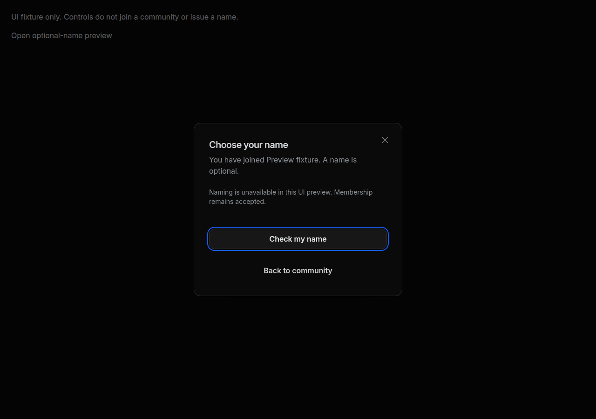

# Application review checkpoint, November 14

This checkpoint exposes the joined application source and a browser UI preview.
It is not a release or a proven fresh-server installation.

The public integration review is [PR58](https://github.com/pirate-social-club/pirate-operators/pull/58).
The independent contract proposal is [Registry PR3](https://github.com/pirate-social-club/pirate-registry/pull/3).
The HNS state machine is [api-next PR723](https://github.com/pirate-social-club/api-next/pull/723);
it remains V3-pinned and is not connected to V4 permits.

## Browser preview

On the workspace machine, open [the preview catalog](http://127.0.0.1:6176/).
The new views use the actual optional-name component:

- [Choose a name](http://127.0.0.1:6176/iframe.html?id=checkpoint-community-optional-name--choose-name&viewMode=story).
- [Naming unavailable](http://127.0.0.1:6176/iframe.html?id=checkpoint-community-optional-name--naming-unavailable&viewMode=story).

These are explicitly supplied UI states. They do not authenticate, accept a
membership, sign, mint or contact a backend. The form can be inspected for copy,
input validation, closing and reopening, keyboard dismissal and responsive
layout. Actions are Storybook callbacks. The catalog also contains the existing
Study, Karaoke and Dance views. Full accessibility, device and Paper acceptance
remain open.





A GitHub-only reviewer cannot access this machine's localhost. To run the
catalog from a checkout, use Node 24 and the package's pinned dependencies:

```sh
cd apps/web
npm ci
npm run storybook -- --host 127.0.0.1 --ci
```

## What was checked

All six typechecks pass: root, web, Wizard, jobs, backend and full-target.
All 26 member journal/API cases and 26 member UI controller cases pass. The
member tests use real Miniflare D1/session primitives with explicit simulated
policy, signing and chain-observation ports; they do not establish those live
services. The normal web Node suite passes all 504 cases, including the 26
member UI cases. Those UI cases are now included in the normal web test command.

Both live-web and Wizard builds pass. The earlier integration baseline's
affected 168-case group and 27 create-only cases pass after two fixture repairs;
the remaining 132 cases passed on the production-identical predecessor.
Those are selected local integration results, not a whole-application release
pass. Required current-head hosted CI remains separate.

The earlier test-loading and unchecked-JSON failures are retained in PR history.
The repair uses Node-compatible class fields and the actual client wire decoders;
it does not remove the negative assertions.

## What is unavailable

There is no proven browser-to-fresh-server setup, restart or first-song journey.
The native member schema, actual policy/context/route mounting, V4 issuer and
canonical receipt producers are not admitted. A displayed fixture does not
prove membership or naming. The separate HTTPS-before-HNS profile and automatic
registration remain deferred source work, not implemented capabilities.

The public V4 contract checkpoint passes 67 local tests and types but remains
311 bytes over its size gate. Its later private encoder proposal is not part
of this app checkpoint. No deployment or funded operation is implied.

New installer/HTTPS/registrar implementation is held for this review. After
feedback, the next task should be one bounded installation slice with one
implementation owner and a visible result, rather than another broad parallel
integration cycle.
